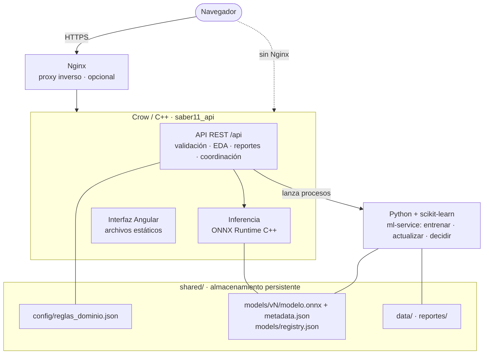
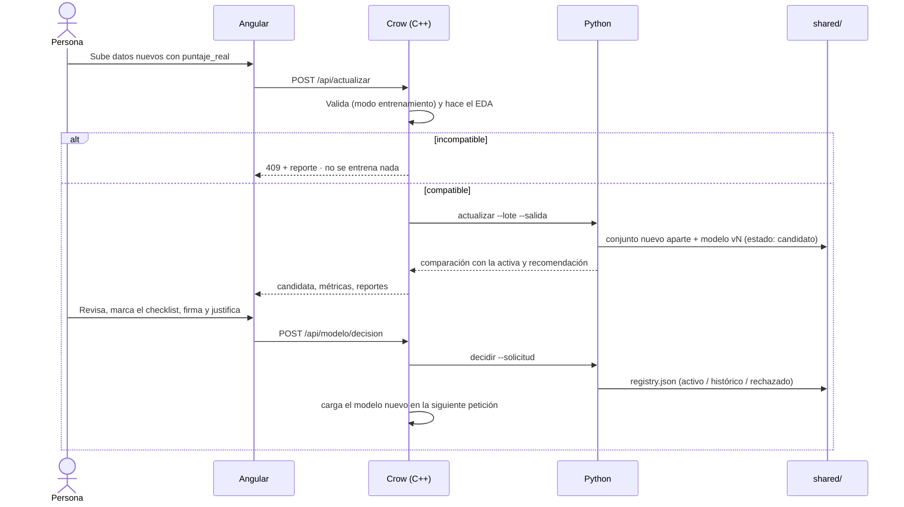

<div align="center">


# SENTINEL

### Predictive Governance Platform

**Valida, explica, predice y gobierna un modelo de IA. Ningún modelo llega a producción sin aprobación humana.**


</div>

---

## Contenido

1. [Qué es SENTINEL](#qué-es-sentinel)
2. [Funcionalidades](#funcionalidades)
3. [Arquitectura](#arquitectura)
4. [Stack tecnológico](#stack-tecnológico)
5. [Estructura del repositorio](#estructura-del-repositorio)
6. [Instalación](#instalación)
7. [Ejecución](#ejecución)
8. [Despliegue en un servidor](#despliegue-en-un-servidor)
9. [Recorrido de demostración](#recorrido-de-demostración)
10. [API REST](#api-rest)
11. [Esquema de datos y validación](#esquema-de-datos-y-validación)
12. [El modelo](#el-modelo)
13. [Versiones y aprobación humana](#versiones-y-aprobación-humana)
14. [EDA automático](#eda-automático)
15. [Reportes](#reportes)
16. [Pruebas](#pruebas)
17. [Seguridad](#seguridad)
18. [Solución de problemas](#solución-de-problemas)
19. [Limitaciones conocidas](#limitaciones-conocidas)
20. [Datos y licencia](#datos-y-licencia)

---

## Qué es SENTINEL

SENTINEL es una plataforma web para **gobernar** un modelo predictivo durante todo su ciclo de vida. El modelo estima
el **puntaje global promedio de Saber 11 que sacará el año siguiente** cada municipio y cada colegio de Colombia (con
foco en el Chocó), y lo acompaña de un intervalo "más o menos".

Lo que la diferencia de una aplicación de predicción común es el **control humano**:

- Ningún archivo llega al modelo sin pasar una **validación** que explica cada problema y nunca corrige datos en silencio.
- Cada reentrenamiento produce una versión **candidata** que se compara con la **activa** usando la misma métrica.
- Solo una persona, con **responsable y justificación escrita**, puede activar o rechazar una candidata.
- Todo queda **versionado y trazable**: qué modelo estuvo en producción, cuándo, con qué datos y quién lo decidió.

## Funcionalidades

| Módulo | Qué hace |
|---|---|
| **Command Center** | Estado del sistema, modelo activo, métrica principal, salud de los componentes, explicación del modelo y actividad |
| **Validación** | Arrastrar y soltar un CSV; recorre 5 niveles (esquema, tipos, contenido, dominio, reglas cruzadas); muestra las diferencias de esquema, un puntaje de salud de los datos y cada hallazgo con lo esperado y lo encontrado |
| **Data Observatory** | EDA automático de cualquier archivo, aunque sea incompatible: perfil, radar de calidad, mapa de vacíos, explorador por variable, histogramas, cajas, frecuencias, correlaciones, dispersión y narrativa automática |
| **Predicciones** | Pronóstico con intervalo de 80 %, segmentación por tipo de unidad y prioridad, distribución, extremos y descarga en CSV |
| **Laboratorio** | Reentrenamiento con datos nuevos etiquetados: validación → EDA → integración → entrenamiento → validación temporal → comparación |
| **Comparación** | Activa frente a candidata, métrica por métrica: quién gana, por cuánto, dónde mejora y dónde empeora, y un resumen ejecutivo |
| **Centro de decisión** | Aprobación al estilo de un *pull request*: verificaciones, recomendación del sistema, riesgos, beneficios, checklist, responsable y justificación |
| **Historial** | *Model Evolution Timeline* (v1 → v2 → …) y el registro de cada entrenamiento y cada decisión, con filtros |

Además: paleta de comandos (`Ctrl/⌘ + K`), modo claro y oscuro, diseño adaptable, navegación con teclado y lista para instalarse como PWA.

## Arquitectura



- **Crow (C++)** atiende la API, valida contra el esquema, calcula el EDA, genera los reportes, coordina el
  entrenamiento y sirve la interfaz compilada.
- **ONNX Runtime (C++)** ejecuta el modelo activo. Se carga una vez y se recarga solo cuando cambia la versión activa.
- **Python (scikit-learn)** entrena, valida, exporta a ONNX, crea las candidatas y registra las decisiones. Nunca
  activa un modelo por su cuenta.
- **`shared/`** es la única fuente de verdad: reglas, datos, modelos de cada versión, registro y reportes.

## Stack tecnológico

| Capa | Tecnología |
|---|---|
| Interfaz | Angular 20 (standalone, Signals, sin zone.js), NgRx Signals Store, Angular Material 3 + CDK, ApexCharts, SCSS con *design tokens*, Service Worker (PWA) |
| Backend | C++17, Crow 1.2.1, Asio 1.30.2, nlohmann/json 3.11.3, rapidcsv 8.84, CMake |
| Inferencia | ONNX Runtime 1.22 (C++) |
| Entrenamiento | Python 3.12+, scikit-learn 1.9.1, skl2onnx 1.20, onnxruntime 1.31, pandas, numpy, DuckDB (preparación de datos) |
| Despliegue | Script de instalación sin sudo, systemd (usuario o sistema), Nginx |

## Estructura del repositorio

```
.
├── crow-service/              Backend C++ (Crow + ONNX Runtime)
│   ├── CMakeLists.txt
│   └── src/
│       ├── main.cpp           Rutas de la API y servidor de la interfaz
│       ├── validador.*        Validación por niveles y estados
│       ├── eda.* reporte_eda.cpp   EDA automático y su reporte
│       ├── modelo.*           Inferencia ONNX y recarga del modelo activo
│       ├── entrenamiento.*    Coordinación con el servicio de Python
│       ├── reportes.*         Reportes de compatibilidad y predicciones
│       └── tabla.*            Lectura de CSV
├── ml-service/                Servicio de entrenamiento (Python)
│   ├── requirements.txt
│   └── app/
│       ├── preparar_datos.py  Tablas de entrada desde los microdatos del ICFES
│       ├── entrenar.py        Validación temporal, exportación ONNX y registro
│       ├── modelo.py          Estimador del modelo (regresión anclada)
│       ├── actualizar.py      Candidata + comparación con la activa
│       ├── decidir.py         Activar o rechazar con justificación
│       ├── registry.py        Registro de versiones
│       └── reporte_actualizacion.py
├── frontend/                  Interfaz Angular
│   └── src/app/
│       ├── core/              API tipada, store, tema, formato
│       ├── layout/            Shell, navegación y paleta de comandos
│       ├── shared/            Sistema de diseño: gráficas, KPI, timeline de evolución…
│       └── paginas/           Las 8 pantallas
├── shared/
│   ├── config/reglas_dominio.json   Esquema y reglas (fuente única para C++ y Python)
│   ├── data/                        entrenamiento.csv, novedades_2022.csv, prediccion_2023.csv
│   └── models/                      registry.json y una carpeta por versión
├── pruebas/                   Escenarios de prueba obligatorios
├── scripts/                   instalar.sh · iniciar.sh · descargar_dependencias.sh
├── deploy/                    systemd (usuario y sistema) y Nginx
└── docs/                      Justificación del modelo
```

## Instalación

### Requisitos

| Herramienta | Versión | Notas |
|---|---|---|
| Sistema | Linux x86_64/arm64 o macOS | Probado en Ubuntu 26.04 y macOS 27 |
| Compilador C++ | g++ 11+ o clang 14+ | C++17 |
| Python | 3.12 o superior | Si no trae `pip`/`venv`, el instalador usa [uv](https://docs.astral.sh/uv/) |
| Node.js | 20 o superior, con npm | Para compilar la interfaz |
| git, curl | — | |
| CMake | 3.20+ | Opcional: si no está, el instalador lo pone dentro del entorno de Python |

No hace falta `sudo` para instalar ni para ejecutar.

### Instalación rápida (recomendada)

```bash
git clone https://github.com/Bello2005/Sentinel.git sentinel
cd sentinel
scripts/instalar.sh
```

El instalador:

1. Crea el entorno de Python `.venv` e instala `ml-service/requirements.txt`.
2. Descarga las dependencias de C++ en `vendor/` según el sistema y la arquitectura (`scripts/descargar_dependencias.sh`).
3. Compila el backend: `crow-service/build/saber11_api`.
4. Compila la interfaz: `frontend/dist/frontend/browser`.

Al terminar:

```bash
scripts/iniciar.sh          # http://localhost:8090
```

### Instalación manual, paso a paso

<details>
<summary>Ver los pasos</summary>

```bash
# 1. Python
python3 -m venv .venv
.venv/bin/pip install -r ml-service/requirements.txt

# 2. Dependencias de C++ (ONNX Runtime, Crow, Asio, json, rapidcsv) en vendor/
scripts/descargar_dependencias.sh

# 3. Backend
cmake -S crow-service -B crow-service/build -DCMAKE_BUILD_TYPE=Release
cmake --build crow-service/build -j --target saber11_api

# 4. Interfaz
cd frontend && npm ci && npx ng build && cd ..
```

</details>

## Ejecución

### Producción (un solo proceso)

```bash
scripts/iniciar.sh
```

| Variable | Por defecto | Uso |
|---|---|---|
| `PUERTO` | `8090` | Puerto HTTP |
| `SABER_HOST` | `0.0.0.0` | Use `127.0.0.1` si Nginx va delante |

Crow sirve la API en `/api` y la interfaz en `/`. Cualquier ruta que no sea `/api` devuelve `index.html`, para que
funcione la navegación de Angular.

### Desarrollo (recarga en caliente)

```bash
# Terminal 1: backend en el puerto 8080
crow-service/build/saber11_api --shared shared --puerto 8080 --python .venv/bin/python --ml-service ml-service

# Terminal 2: interfaz en http://localhost:4200 (/api va a Crow por frontend/proxy.conf.json)
cd frontend && npx ng serve
```

Opciones de `saber11_api`: `--shared`, `--puerto`, `--python`, `--ml-service`, `--web` y `--host`
(equivalentes por variable de entorno: `SABER_SHARED`, `PUERTO`, `SABER_PYTHON`, `SABER_ML`, `SABER_WEB`, `SABER_HOST`).

### Regenerar los datos y el modelo

Solo si se tienen los microdatos del ICFES (`../datos/saber11_limpio.parquet`, del proyecto de análisis):

```bash
cd ml-service
../.venv/bin/python -m app.preparar_datos      # escribe shared/data/
../.venv/bin/python -m app.entrenar --activar  # entrena, valida, exporta y registra una versión
```

## Despliegue en un servidor

### Opción A · Sin permisos de administrador (servicio de usuario)

```bash
git clone https://github.com/Bello2005/Sentinel.git ~/sentinel && cd ~/sentinel
scripts/instalar.sh
mkdir -p ~/.config/systemd/user
cp deploy/systemd/sentinel-usuario.service ~/.config/systemd/user/sentinel.service
systemctl --user daemon-reload
systemctl --user enable --now sentinel
loginctl enable-linger "$USER"     # sigue corriendo al cerrar la sesión SSH
```

La aplicación queda en `http://IP-DEL-SERVIDOR:8090`.

```bash
systemctl --user status sentinel      # estado
journalctl --user -u sentinel -f      # registros en vivo
systemctl --user restart sentinel     # reiniciar
```

### Opción B · Servicio de sistema + Nginx + HTTPS (con sudo)

```bash
sudo cp deploy/systemd/sentinel.service /etc/systemd/system/      # ajuste User y rutas si no es /home/bello/sentinel
sudo systemctl daemon-reload && sudo systemctl enable --now sentinel

sudo cp deploy/nginx/sentinel.conf /etc/nginx/sites-available/sentinel   # cambie server_name por su dominio
sudo ln -s /etc/nginx/sites-available/sentinel /etc/nginx/sites-enabled/sentinel
sudo nginx -t && sudo systemctl reload nginx

sudo certbot --nginx -d su-dominio.com    # HTTPS con Let's Encrypt
```

El servicio de sistema escucha solo en `127.0.0.1` y tiene endurecimiento de systemd: solo puede escribir en
`shared/`. Nginx publica la aplicación, comprime las respuestas y admite archivos de hasta 50 MB.

### Actualizar un despliegue

```bash
cd ~/sentinel && git pull
scripts/instalar.sh                    # recompila lo necesario
systemctl --user restart sentinel      # o: sudo systemctl restart sentinel
```

> `shared/models/` y `shared/data/` viven en el servidor: las versiones que se entrenan y aprueban allí se conservan
> entre actualizaciones. Haga copia de `shared/` antes de cambios grandes.

## Recorrido de demostración

1. **Validación → Cargar ejemplo → Compatible**: archivo listo para predecir, salud de los datos alta.
2. **Cargar ejemplo → Falta una variable** (o *Tipo incompatible*, *Valores faltantes*, *Categoría nueva*): estado
   *Incompatible*, la etapa que falla en el recorrido y cada hallazgo con sus filas.
3. **Data Observatory → Cargar ejemplo → Solo para EDA**: un archivo incompatible que igual se puede analizar; los
   atípicos sembrados (650, −12, 87) aparecen solos.
4. **Predicciones → Generar predicciones** con el archivo compatible: 155 unidades con intervalo.
5. **Laboratorio → Cargar ejemplo → Novedades 2022 → Entrenar versión candidata**: nace v2 como candidata.
6. **Comparación**: v1 frente a v2, métrica por métrica.
7. **Centro de decisión**: checklist, responsable, justificación → **Activar v2**.
8. **Historial**: el *Model Evolution Timeline* muestra v1 → v2 con la decisión.

Para volver al estado inicial (solo v1 activa), restaure `shared/models/` desde git: `git checkout -- shared/models`
y borre `shared/models/v2`, `shared/data/versiones`, `shared/data/lotes` y `shared/reportes`.

## API REST

Base: `/api`. Los archivos se envían como `multipart/form-data` en el campo `archivo` (o como cuerpo crudo).
Los errores devuelven `{"error": "mensaje legible"}`, nunca trazas técnicas.

| Método | Ruta | Función | Respuestas |
|---|---|---|---|
| `GET` | `/api/salud` | Estado del servicio y modelo activo | 200 |
| `GET` | `/api/modelo` | Metadatos del modelo activo y registro de versiones | 200 · 503 sin modelo |
| `POST` | `/api/validar?modo=prediccion` | Valida un CSV; `modo=entrenamiento` exige `puntaje_real` | 200 · 400 |
| `POST` | `/api/eda` | EDA automático de cualquier CSV | 200 · 400 |
| `POST` | `/api/predecir` | Valida y, solo si no hay errores, predice | 200 · **409 incompatible, sin predicciones** |
| `POST` | `/api/actualizar` | Datos etiquetados → EDA → candidata → comparación | 200 · 409 · 400 |
| `POST` | `/api/modelo/decision` | `{"version","accion":"activar"\|"rechazar","justificacion","responsable"}` | 200 · 400 |
| `GET` | `/api/reportes/<id>/<archivo>` | Descarga un reporte generado | 200 · 404 |

```bash
curl -F "archivo=@pruebas/01_compatible.csv" http://localhost:8090/api/predecir
curl -F "archivo=@pruebas/08_novedades_2022_etiquetadas.csv" http://localhost:8090/api/actualizar
curl -X POST -H "Content-Type: application/json" \
     -d '{"version":"v2","accion":"activar","responsable":"Equipo","justificacion":"Incorpora 2022 y no empeora"}' \
     http://localhost:8090/api/modelo/decision
```

<details>
<summary>Ejemplo de respuesta de <code>/api/validar</code></summary>

```json
{
  "id": "20261022-184435-c1b1",
  "estado": "incompatible",
  "modo": "prediccion",
  "filas": 155,
  "filas_con_errores": 0,
  "columnas": { "esperadas": ["codigo", "…"], "recibidas": ["…"], "faltantes": ["promedio_3"], "adicionales": [] },
  "resumen": { "errores": 1, "advertencias": 0 },
  "problemas": [{
    "nivel": "error", "categoria": "esquema", "variable": "promedio_3",
    "mensaje": "Falta una columna obligatoria (predictora).",
    "esperado": "columna 'promedio_3'", "encontrado": "no está en el archivo",
    "filas_afectadas": 0, "ejemplo_filas": []
  }],
  "descargas": { "compatibilidad.html": "/api/reportes/…/compatibilidad.html", "compatibilidad.json": "…" }
}
```

</details>

## Esquema de datos y validación

Cada fila es una **unidad** (municipio o colegio) y el **año que se quiere predecir**. La definición completa está en
[`shared/config/reglas_dominio.json`](shared/config/reglas_dominio.json), que leen tanto Crow como Python: las reglas
no están escritas en la interfaz.

| Columna | Rol | Tipo | Regla |
|---|---|---|---|
| `codigo` | identificador | texto | 5 dígitos (municipio) o 12 (colegio) |
| `nombre`, `departamento_cod`, `municipio_cod` | identificador | texto | códigos DANE |
| `anio_objetivo`, `anio_ultimo` | identificador | entero | 2014–2040 |
| `puntaje_ultimo`, `puntaje_anterior`, `promedio_3`, `puntaje_grupo` | **predictora** | número | 0–500, sin vacíos |
| `tipo_unidad` | auxiliar | categórica | `municipio` o `colegio`; una categoría nueva se rechaza |
| `anios_desde_ultimo` | auxiliar | entero | 1–4, igual a `anio_objetivo − anio_ultimo` |
| `estudiantes_ultimo` | auxiliar | entero | ≥ 1; menos de 10 genera una advertencia |
| `pct_internet`, `pct_madre_superior`, `pct_extraedad`, `pct_rural`, `pct_oficial` | informativa | número | 0–1, opcionales |
| `puntaje_real` | **objetivo** | número | 0–500; obligatorio solo para actualizar el modelo |

**Niveles de validación:** esquema → tipo → contenido → dominio → reglas cruzadas (coherencia de años, código
según tipo, filas duplicadas).

**Estados:**

| Estado | Significado | ¿Predice? |
|---|---|---|
| `compatible` | Cumple todo | Sí |
| `compatible_con_advertencias` | Se puede procesar, pero hay columnas adicionales o advertencias | Sí |
| `incompatible` | Al menos un error | **No** (HTTP 409) |

El sistema **nunca rellena ni corrige** datos: indica la variable, lo esperado, lo encontrado y las filas afectadas
(numeradas como en Excel), para que el usuario corrija y vuelva a validar.

## El modelo

**Regresión anclada en el promedio de los últimos 3 años** (`ml-service/app/modelo.py`):

```
predicción = promedio_3 + b1·(puntaje_ultimo − promedio_3) + b2·(puntaje_anterior − promedio_3) + b3·(puntaje_grupo − promedio_3)
```

Los coeficientes se estiman con Ridge **sin intercepto** sobre el residuo, para que el modelo no aprenda subidas o
bajadas generales del país, que no siguen ningún patrón. El preprocesamiento y el modelo forman un `Pipeline` de
scikit-learn que se exporta a ONNX; C++ y Python dan las mismas predicciones (diferencia máxima de 0,00005 puntos).

**Validación (temporal):** cada año se predice solo con los años anteriores. Métrica principal: error absoluto medio
(MAE, en puntos de la escala 0–500) en las unidades del Chocó.

| Modelo | MAE Chocó (v1, años 2015–2020) |
|---|---|
| Repetir el último año | 11,06 |
| Promedio de 3 años | 9,83 |
| **SENTINEL v1** | **9,75** |

El intervalo de 80 % se calcula con los errores de la validación, según el tipo de unidad y su tamaño (de unos ±13
puntos en colegios grandes a unos ±22 en colegios con menos de 10 estudiantes).

Alternativas probadas y descartadas, razones de la elección y limitaciones:
[`docs/justificacion_modelo.md`](docs/justificacion_modelo.md).

## Versiones y aprobación humana



Cada versión guarda en `shared/models/vN/`: `modelo.onnx`, `pipeline.joblib`, `metadata.json` (fecha, registros,
variables, algoritmo, configuración, métricas, intervalos, categorías válidas) y `validacion.csv`.
`registry.json` registra el estado de cada una (**activo**, **candidato**, **histórico** o **rechazado**), con qué
datos se entrenó y la decisión (acción, responsable, justificación, fecha y versión activa previa).

La candidata **nunca** reemplaza a la activa sin una decisión. El conjunto de entrenamiento de la versión activa no se
modifica: cada candidata tiene el suyo en `shared/data/versiones/`.

## EDA automático

`POST /api/eda` analiza cualquier CSV. No usa una plantilla fija: primero clasifica cada columna y decide qué medir.

| Tipo detectado | Criterio | Análisis | Gráfica |
|---|---|---|---|
| numérica | ≥ 95 % de valores numéricos | media, desviación, cuartiles, asimetría, atípicos | histograma y caja |
| discreta | entera con ≤ 10 valores distintos | frecuencias | barras |
| categórica | texto con ≤ 50 valores distintos | frecuencias y proporciones | barras |
| temporal | años o fechas | registros por periodo | línea |
| identificador / texto | `codigo`, `*_cod` o un valor por fila | longitudes, repetidos | — |

También calcula vacíos por variable, filas duplicadas, correlaciones de Pearson (|r| ≥ 0,3), asociación entre
categóricas y numéricas (eta² ≥ 0,06) y atípicos con la regla de Tukey (1,5·RIC). Las observaciones se escriben de
forma automática y **nunca afirman causalidad**.

## Reportes

| Reporte | Archivo | Contenido |
|---|---|---|
| EDA | `eda.html`, `eda.json` | Resumen, calidad, estadísticas, gráficas interactivas y observaciones |
| Compatibilidad | `compatibilidad.html`, `compatibilidad.json` | Columnas esperadas y recibidas, tipos, errores, advertencias y estado |
| Predicciones | `predicciones.csv`, `predicciones_resumen.json` | Cada registro con predicción e intervalo, y un resumen general |
| Actualización | `actualizacion.html`, `actualizacion.json`, `eda_nuevos.*`, `eda_conjunto.*` | Datos nuevos, comparación activa/candidata, métricas, recomendación y decisión |

Se guardan en `shared/reportes/<id>/` y se descargan desde la interfaz o con `GET /api/reportes/<id>/<archivo>`.

## Pruebas

Los archivos de [`pruebas/`](pruebas/) cubren los escenarios obligatorios y se cargan desde la interfaz con
**Cargar ejemplo**. Se regeneran con `python pruebas/generar_pruebas.py`.

| # | Archivo | Escenario | Resultado |
|---|---|---|---|
| 1 | `01_compatible.csv` | Completamente compatible | `compatible`, 155 predicciones |
| 2 | `02_falta_variable.csv` | Falta `promedio_3` | `incompatible` (esquema) |
| 3 | `03_tipo_incompatible.csv` | Texto en `puntaje_ultimo` | `incompatible` (tipo), filas 5, 12 y 27 |
| 4 | `04_faltantes.csv` | Vacíos en `puntaje_anterior` | `incompatible`, 4 filas; no se rellenan |
| 5 | `05_categoria_nueva.csv` | `tipo_unidad = departamento` | `incompatible`, categoría no vista |
| 6 | `06_columnas_adicionales.csv` | Columnas extra | `compatible_con_advertencias`; predice |
| 7 | `07_solo_eda.csv` | Incompatible, pero analizable | no predice; el EDA sí funciona |
| 8 | `08_novedades_2022_etiquetadas.csv` | Datos nuevos con `puntaje_real` | genera la candidata v2 |
| + | `09_reglas_de_dominio.csv` | Fuera de rango, años incoherentes, duplicado | `incompatible` (dominio y reglas) |

Detalle y comandos `curl` en [`pruebas/README.md`](pruebas/README.md).

## Seguridad

- Las predicciones solo se ejecutan después de aprobar la validación; un archivo incompatible responde 409.
- El texto que escribe el usuario (la justificación) nunca pasa por la línea de comandos: viaja en un archivo JSON.
- Solo corre un entrenamiento a la vez.
- La descarga de reportes acepta identificadores y nombres de archivo conocidos; el servidor de la interfaz no sirve
  nada fuera de su carpeta.
- Los errores de Python se guardan en un log y el usuario solo ve el mensaje.
- `pipeline.joblib` es un *pickle*: cargue solo archivos de fuentes confiables. La inferencia usa el `.onnx`.
- En producción, ponga Nginx con HTTPS delante y deje Crow en `127.0.0.1` (opción B del despliegue).

## Solución de problemas

| Síntoma | Causa y solución |
|---|---|
| `No hay conexión con el backend (Crow)` en la interfaz | Crow no está corriendo o no está en el puerto esperado. `scripts/iniciar.sh` o, en desarrollo, Crow en el 8080 |
| El instalador dice que Python no trae `pip` | Ubuntu sin `python3-venv`: el instalador usa `uv` en `~/.local/bin`. Con sudo: `sudo apt install python3-venv` |
| `cmake: command not found` | El instalador lo pone en `.venv/bin/cmake`; o instale CMake 3.20+ |
| `libonnxruntime… not found` al iniciar | Faltan las dependencias de C++: `scripts/descargar_dependencias.sh` y recompile |
| macOS: "no se puede abrir porque es de un desarrollador no identificado" | `xattr -r -d com.apple.quarantine vendor/onnxruntime` (el script ya lo hace) |
| `El servicio de entrenamiento falló` | Revise `shared/reportes/<id>/python.log`; verifique `--python` y `--ml-service` |
| El servicio de usuario se detiene al cerrar SSH | `loginctl enable-linger $USER` |
| Puerto ocupado | `PUERTO=9000 scripts/iniciar.sh` |

## Limitaciones conocidas

- El modelo le gana al promedio de 3 años por poco (unos 0,1 puntos). Su valor está en el flujo controlado, versionado
  y explicable, con intervalos.
- Ningún modelo con estos datos anticipa choques nacionales (cambios del examen, años atípicos como 2019).
- Faltan 2018 y 2021 en los datos abiertos; cuando lleguen, se incorporan con el flujo de actualización sin cambiar
  código.
- La carga de archivos acepta CSV (separados por coma o punto y coma); Excel se debe guardar antes como CSV UTF-8.
- El reporte HTML del EDA carga ECharts desde internet para dibujar las gráficas.

## Datos y licencia

Los datos provienen de **Resultados únicos Saber 11** del **ICFES**
([datos.gov.co](https://www.datos.gov.co/d/kgxf-xxbe)), publicados con licencia
**[CC BY-SA 4.0](https://creativecommons.org/licenses/by-sa/4.0/deed.es)**. Los archivos de `shared/data/` y
`pruebas/` son **agregados por municipio y colegio** (no contienen datos de estudiantes) y se comparten con la misma
licencia. Fuente: ICFES.

<div align="center">
<sub>SENTINEL · Human-controlled AI</sub>
</div>
